# Team Rankings

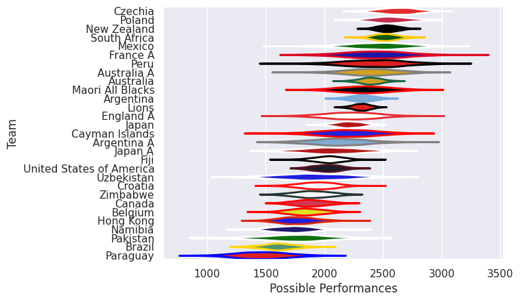
# Standings

## Current Standings

| Club                     |   Played |   Wins |   Point Differential |   Losing Bonus Points |   Try Bonus Points |   Competition Points |
|:-------------------------|---------:|-------:|---------------------:|----------------------:|-------------------:|---------------------:|
| Australia                |        7 |      4 |                   -1 |                     0 |                  4 |                   22 |
| New Zealand              |        3 |      3 |                   59 |                     0 |                  3 |                   15 |
| Japan                    |        4 |      1 |                   -3 |                     2 |                  3 |                    9 |
| South Africa             |        2 |      1 |                    3 |                     1 |                  1 |                    6 |
| Fiji                     |        1 |      1 |                    6 |                     0 |                  1 |                    5 |
| Zimbabwe                 |        1 |      1 |                    3 |                     0 |                  1 |                    5 |
| Argentina                |        3 |      0 |                  -13 |                     2 |                  1 |                    5 |
| Australia A              |        1 |      1 |                   49 |                     0 |                    |                    4 |
| France A                 |        1 |      1 |                   16 |                     0 |                    |                    4 |
| Poland                   |        1 |      1 |                   14 |                     0 |                    |                    4 |
| Czechia                  |        2 |      1 |                   13 |                     0 |                    |                    4 |
| Maori All Blacks         |        1 |      1 |                    7 |                     0 |                    |                    4 |
| Mexico                   |        2 |      1 |                  -11 |                     0 |                    |                    4 |
| United States of America |        2 |      1 |                  -48 |                     0 |                    |                    4 |
| Namibia                  |        1 |      0 |                   -3 |                     1 |                  1 |                    2 |
| Lions                    |        1 |      0 |                   -6 |                     1 |                  1 |                    2 |
| Argentina A              |        1 |      0 |                   -1 |                     1 |                    |                    1 |
| Japan A                  |        1 |      0 |                   -7 |                     1 |                    |                    1 |
| Croatia                  |        1 |      0 |                  -16 |                     0 |                    |                    0 |
| England A                |        1 |      0 |                  -16 |                     0 |                    |                    0 |
| Canada                   |        1 |      0 |                  -45 |                     0 |                    |                    0 |

## Projected Remaining Table

| Club                     |   To Play |   Projected Wins |   Projected Differential |   Projected Losing Bonus Points | Projected Try Bonus Points   |   Projected Competition Points |
|:-------------------------|----------:|-----------------:|-------------------------:|--------------------------------:|:-----------------------------|-------------------------------:|
| Pakistan                 |         2 |            1.292 |                   21.655 |                           0.172 |                              |                          5.4   |
| Australia A              |         1 |            0.936 |                   19.698 |                           0.039 |                              |                          3.807 |
| New Zealand              |         1 |            0.9   |                   11.751 |                           0.063 |                              |                          3.703 |
| Paraguay                 |         1 |            0.879 |                   22.245 |                           0.051 |                              |                          3.593 |
| Belgium                  |         1 |            0.718 |                    8.182 |                           0.135 |                              |                          3.059 |
| England A                |         1 |            0.705 |                   11.935 |                           0.099 |                              |                          2.961 |
| Uzbekistan               |         2 |            0.678 |                  -21.655 |                           0.177 |                              |                          2.949 |
| Hong Kong                |         1 |            0.256 |                   -8.182 |                           0.203 |                              |                          1.279 |
| Argentina A              |         1 |            0.274 |                  -11.935 |                           0.113 |                              |                          1.251 |
| Australia                |         1 |            0.08  |                  -11.751 |                           0.217 |                              |                          0.577 |
| Brazil                   |         1 |            0.108 |                  -22.245 |                           0.093 |                              |                          0.551 |
| United States of America |         1 |            0.052 |                  -19.698 |                           0.129 |                              |                          0.361 |

## Projected Total Table

| Club                     |   Played |   Wins |   Point Differential |   Losing Bonus Points |   Try Bonus Points |   Competition Points |
|:-------------------------|---------:|-------:|---------------------:|----------------------:|-------------------:|---------------------:|
| Australia                |        8 |  4.08  |              -12.751 |                 0.217 |                  4 |               22.577 |
| New Zealand              |        4 |  3.9   |               70.751 |                 0.063 |                  3 |               18.703 |
| Japan                    |        4 |  1     |               -3     |                 2     |                  3 |                9     |
| Australia A              |        2 |  1.936 |               68.698 |                 0.039 |                    |                7.807 |
| South Africa             |        2 |  1     |                3     |                 1     |                  1 |                6     |
| Pakistan                 |        2 |  1.292 |               21.655 |                 0.172 |                    |                5.4   |
| Fiji                     |        1 |  1     |                6     |                 0     |                  1 |                5     |
| Zimbabwe                 |        1 |  1     |                3     |                 0     |                  1 |                5     |
| Argentina                |        3 |  0     |              -13     |                 2     |                  1 |                5     |
| United States of America |        3 |  1.052 |              -67.698 |                 0.129 |                    |                4.361 |
| France A                 |        1 |  1     |               16     |                 0     |                    |                4     |
| Poland                   |        1 |  1     |               14     |                 0     |                    |                4     |
| Czechia                  |        2 |  1     |               13     |                 0     |                    |                4     |
| Maori All Blacks         |        1 |  1     |                7     |                 0     |                    |                4     |
| Mexico                   |        2 |  1     |              -11     |                 0     |                    |                4     |
| Paraguay                 |        1 |  0.879 |               22.245 |                 0.051 |                    |                3.593 |
| Belgium                  |        1 |  0.718 |                8.182 |                 0.135 |                    |                3.059 |
| England A                |        2 |  0.705 |               -4.065 |                 0.099 |                    |                2.961 |
| Uzbekistan               |        2 |  0.678 |              -21.655 |                 0.177 |                    |                2.949 |
| Argentina A              |        2 |  0.274 |              -12.935 |                 1.113 |                    |                2.251 |
| Namibia                  |        1 |  0     |               -3     |                 1     |                  1 |                2     |
| Lions                    |        1 |  0     |               -6     |                 1     |                  1 |                2     |
| Hong Kong                |        1 |  0.256 |               -8.182 |                 0.203 |                    |                1.279 |
| Japan A                  |        1 |  0     |               -7     |                 1     |                    |                1     |
| Brazil                   |        1 |  0.108 |              -22.245 |                 0.093 |                    |                0.551 |
| Croatia                  |        1 |  0     |              -16     |                 0     |                    |                0     |
| Canada                   |        1 |  0     |              -45     |                 0     |                    |                0     |

# Completed Match Review

| Model | Percent Correct Predictions | Spread Error |
| ------ | ------ | ------ |
| Club Level | 84.6% | 10.8 |
| Player Level: Lineup | nan% | nan |
| Player Level: Minutes | nan% | nan |

# Future Predictions

## Week 8

### New Zealand V Australia on 2026/10/01

Average Margin: New Zealand by 11.8

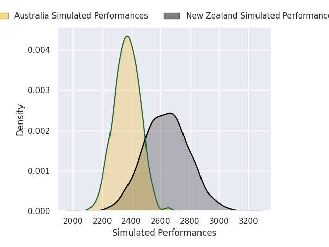
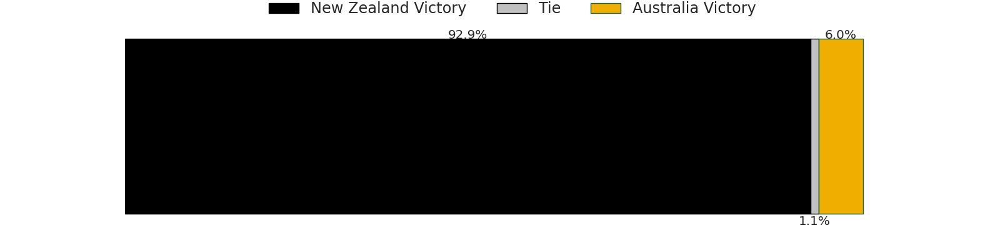
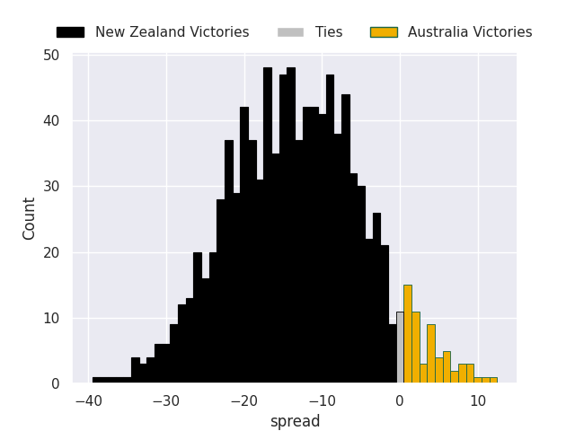

## Week 9

### United States of America V Australia A on 2026/10/31

Average Margin: Australia A by 19.7

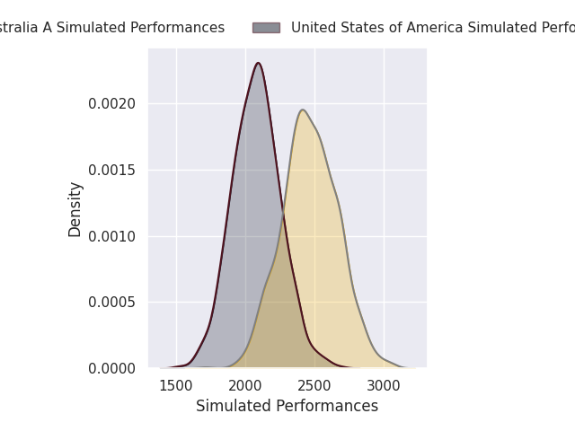
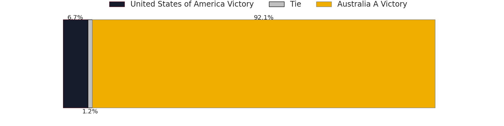
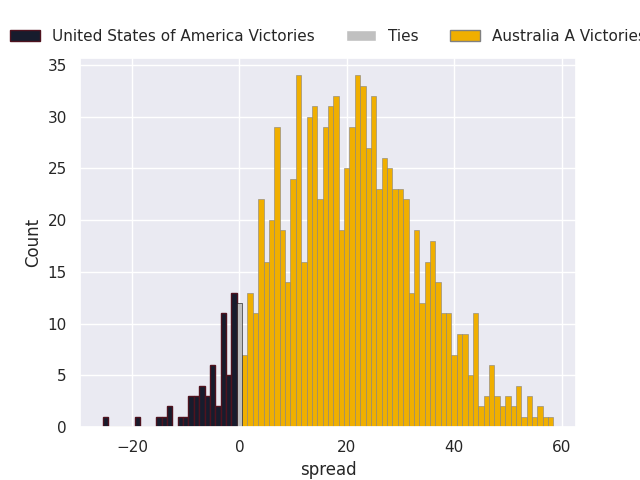

### Belgium V Hong Kong on 2026/10/31

Average Margin: Belgium by 8.2

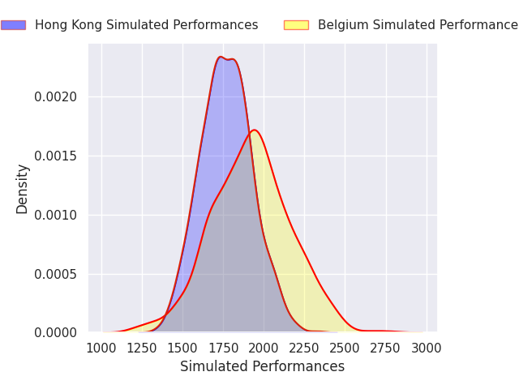
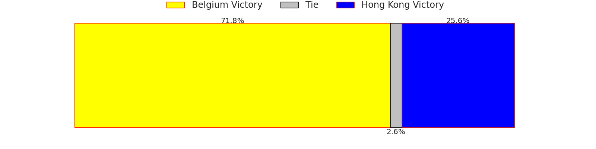
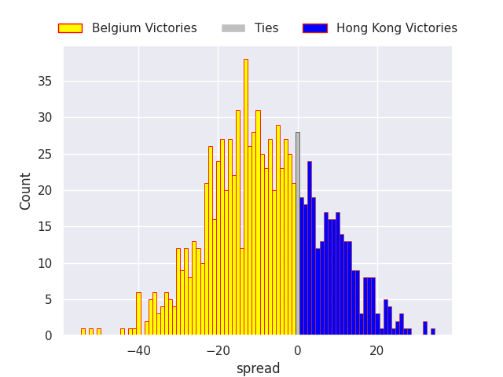

## Week 10

### England A V Argentina A on 2026/11/06

Average Margin: England A by 11.9

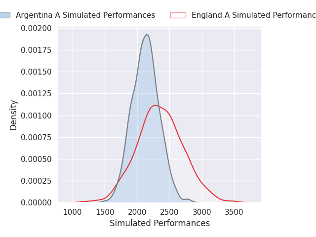
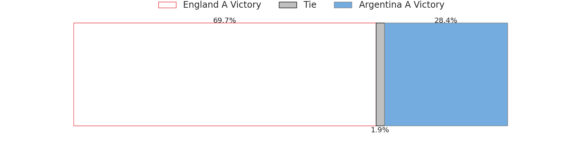
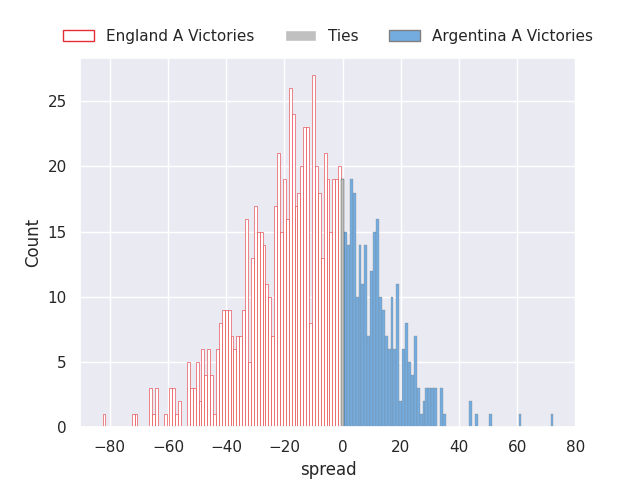

### Pakistan V Uzbekistan on 2026/11/08

Average Margin: Pakistan by 11.2

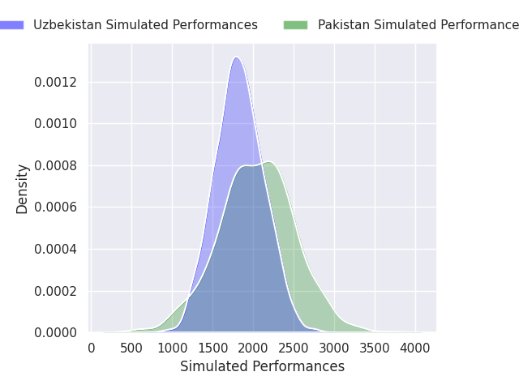
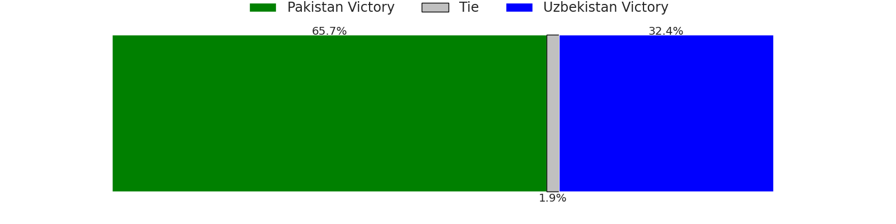
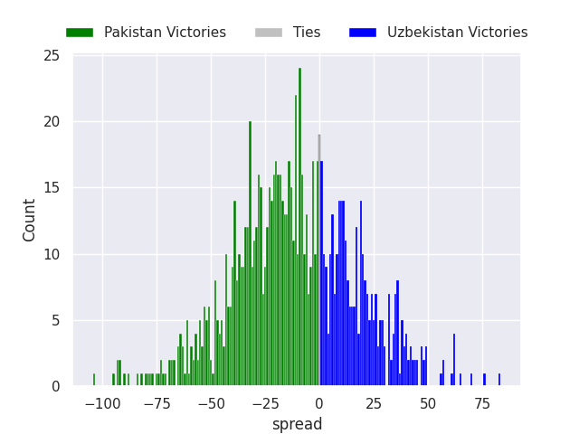

## Week 11

### Pakistan V Uzbekistan on 2026/11/12

Average Margin: Pakistan by 10.5

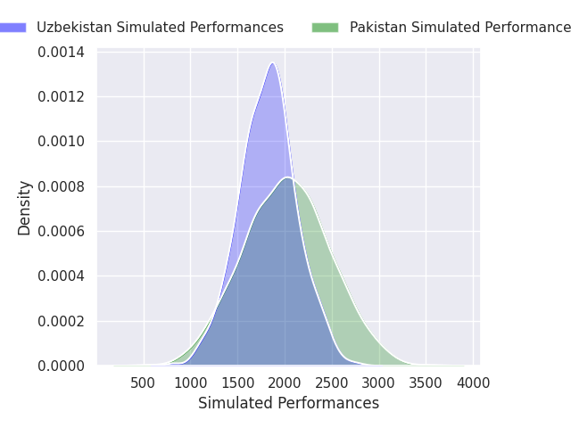

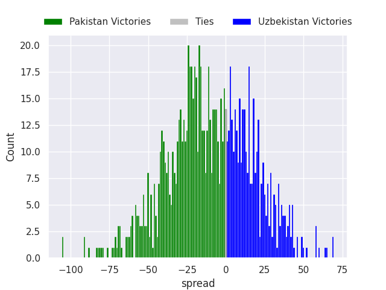

### Paraguay V Brazil on 2026/11/13

Average Margin: Paraguay by 22.2

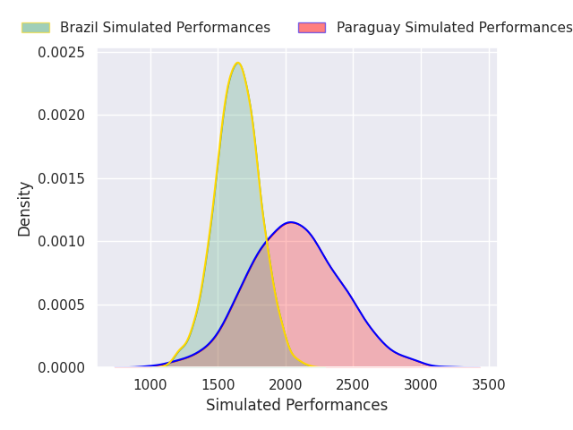
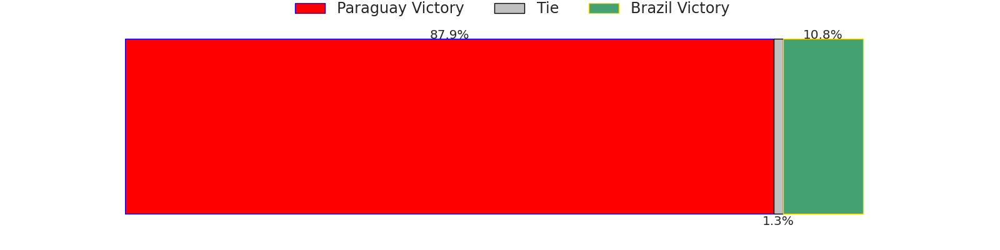
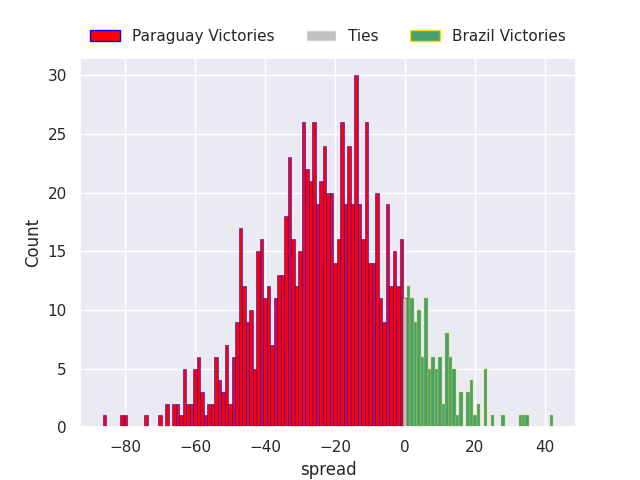

