# Team Rankings

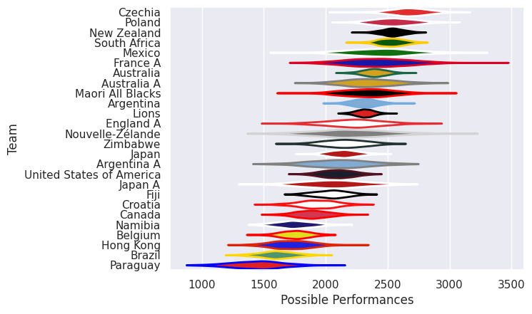
# Standings

## Current Standings

| Club                     |   Played |   Wins |   Point Differential |   Losing Bonus Points |   Try Bonus Points |   Competition Points |
|:-------------------------|---------:|-------:|---------------------:|----------------------:|-------------------:|---------------------:|
| Australia                |        9 |      4 |                  -54 |                     0 |                  4 |                   22 |
| New Zealand              |        3 |      3 |                   59 |                     0 |                  3 |                   15 |
| Nouvelle-Zélande         |        2 |      2 |                   53 |                     0 |                  2 |                   10 |
| Japan                    |        3 |      1 |                    3 |                     1 |                  2 |                    7 |
| South Africa             |        2 |      1 |                    3 |                     1 |                  1 |                    6 |
| Argentina                |        3 |      0 |                  -13 |                     2 |                  1 |                    5 |
| France A                 |        1 |      1 |                   16 |                     0 |                    |                    4 |
| Poland                   |        1 |      1 |                   14 |                     0 |                    |                    4 |
| Czechia                  |        2 |      1 |                   13 |                     0 |                    |                    4 |
| Maori All Blacks         |        1 |      1 |                    7 |                     0 |                    |                    4 |
| United States of America |        1 |      1 |                    1 |                     0 |                    |                    4 |
| Mexico                   |        2 |      1 |                  -11 |                     0 |                    |                    4 |
| Lions                    |        1 |      0 |                   -6 |                     1 |                  1 |                    2 |
| Argentina A              |        1 |      0 |                   -1 |                     1 |                    |                    1 |
| Japan A                  |        1 |      0 |                   -7 |                     1 |                    |                    1 |
| Croatia                  |        1 |      0 |                  -16 |                     0 |                    |                    0 |
| England A                |        1 |      0 |                  -16 |                     0 |                    |                    0 |
| Canada                   |        1 |      0 |                  -45 |                     0 |                    |                    0 |

## Projected Remaining Table

| Club                     |   To Play |   Projected Wins |   Projected Differential |   Projected Losing Bonus Points | Projected Try Bonus Points   |   Projected Competition Points |
|:-------------------------|----------:|-----------------:|-------------------------:|--------------------------------:|:-----------------------------|-------------------------------:|
| Australia A              |         2 |            1.66  |                   29.054 |                           0.175 |                              |                          6.889 |
| Japan                    |         1 |            0.902 |                   14.216 |                           0.058 |                              |                          3.694 |
| New Zealand              |         1 |            0.87  |                   10.987 |                           0.085 |                              |                          3.619 |
| Paraguay                 |         1 |            0.871 |                   20.848 |                           0.052 |                              |                          3.562 |
| Zimbabwe                 |         1 |            0.749 |                   10.761 |                           0.095 |                              |                          3.129 |
| England A                |         1 |            0.72  |                   12.205 |                           0.085 |                              |                          2.999 |
| Belgium                  |         1 |            0.688 |                    7.376 |                           0.147 |                              |                          2.955 |
| United States of America |         2 |            0.303 |                  -29.054 |                           0.28  |                              |                          1.566 |
| Hong Kong                |         1 |            0.284 |                   -7.376 |                           0.188 |                              |                          1.38  |
| Argentina A              |         1 |            0.263 |                  -12.205 |                           0.123 |                              |                          1.209 |
| Namibia                  |         1 |            0.232 |                  -10.761 |                           0.16  |                              |                          1.126 |
| Australia                |         1 |            0.103 |                  -10.987 |                           0.225 |                              |                          0.691 |
| Brazil                   |         1 |            0.116 |                  -20.848 |                           0.092 |                              |                          0.582 |
| Fiji                     |         1 |            0.084 |                  -14.216 |                           0.18  |                              |                          0.544 |

## Projected Total Table

| Club                     |   Played |   Wins |   Point Differential |   Losing Bonus Points |   Try Bonus Points |   Competition Points |
|:-------------------------|---------:|-------:|---------------------:|----------------------:|-------------------:|---------------------:|
| Australia                |       10 |  4.103 |              -64.987 |                 0.225 |                  4 |               22.691 |
| New Zealand              |        4 |  3.87  |               69.987 |                 0.085 |                  3 |               18.619 |
| Japan                    |        4 |  1.902 |               17.216 |                 1.058 |                  2 |               10.694 |
| Nouvelle-Zélande         |        2 |  2     |               53     |                 0     |                  2 |               10     |
| Australia A              |        2 |  1.66  |               29.054 |                 0.175 |                    |                6.889 |
| South Africa             |        2 |  1     |                3     |                 1     |                  1 |                6     |
| United States of America |        3 |  1.303 |              -28.054 |                 0.28  |                    |                5.566 |
| Argentina                |        3 |  0     |              -13     |                 2     |                  1 |                5     |
| France A                 |        1 |  1     |               16     |                 0     |                    |                4     |
| Poland                   |        1 |  1     |               14     |                 0     |                    |                4     |
| Czechia                  |        2 |  1     |               13     |                 0     |                    |                4     |
| Maori All Blacks         |        1 |  1     |                7     |                 0     |                    |                4     |
| Mexico                   |        2 |  1     |              -11     |                 0     |                    |                4     |
| Paraguay                 |        1 |  0.871 |               20.848 |                 0.052 |                    |                3.562 |
| Zimbabwe                 |        1 |  0.749 |               10.761 |                 0.095 |                    |                3.129 |
| England A                |        2 |  0.72  |               -3.795 |                 0.085 |                    |                2.999 |
| Belgium                  |        1 |  0.688 |                7.376 |                 0.147 |                    |                2.955 |
| Argentina A              |        2 |  0.263 |              -13.205 |                 1.123 |                    |                2.209 |
| Lions                    |        1 |  0     |               -6     |                 1     |                  1 |                2     |
| Hong Kong                |        1 |  0.284 |               -7.376 |                 0.188 |                    |                1.38  |
| Namibia                  |        1 |  0.232 |              -10.761 |                 0.16  |                    |                1.126 |
| Japan A                  |        1 |  0     |               -7     |                 1     |                    |                1     |
| Brazil                   |        1 |  0.116 |              -20.848 |                 0.092 |                    |                0.582 |
| Fiji                     |        1 |  0.084 |              -14.216 |                 0.18  |                    |                0.544 |
| Croatia                  |        1 |  0     |              -16     |                 0     |                    |                0     |
| Canada                   |        1 |  0     |              -45     |                 0     |                    |                0     |

# Completed Match Review

| Model | Percent Correct Predictions | Spread Error |
| ------ | ------ | ------ |
| Club Level | 76.9% | 12.0 |
| Player Level: Lineup | nan% | nan |
| Player Level: Minutes | nan% | nan |

# Future Predictions

## Week 10

### New Zealand V Australia on 2026/10/01

Average Margin: New Zealand by 11.0

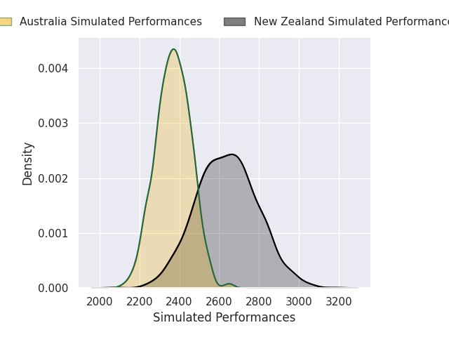
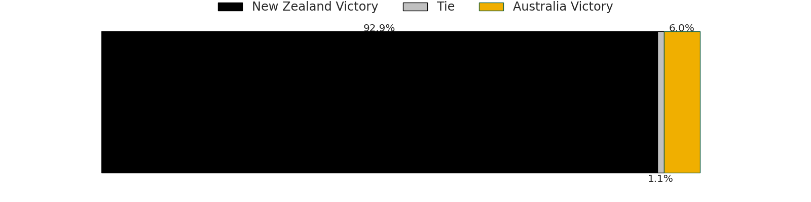
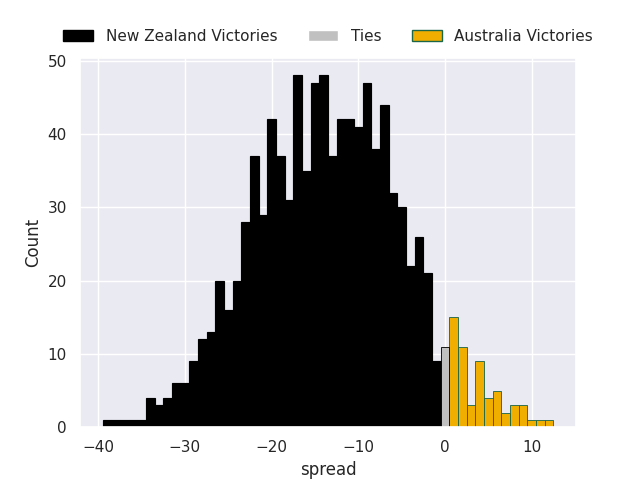

## Week 11

### Japan V Fiji on 2026/10/24

Average Margin: Japan by 14.2

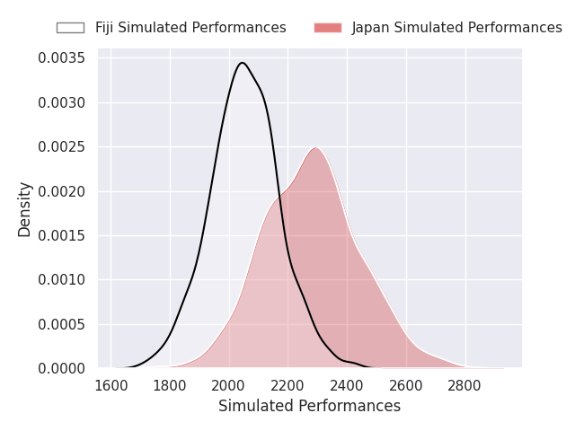
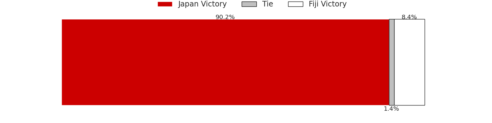
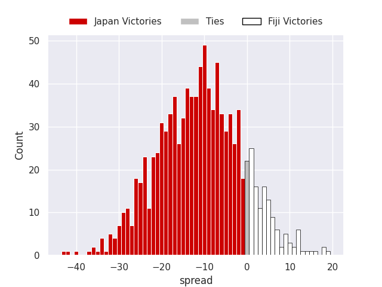

### Zimbabwe V Namibia on 2026/10/24

Average Margin: Zimbabwe by 10.8

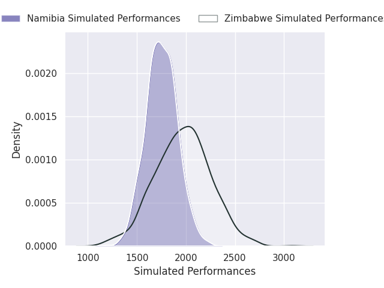
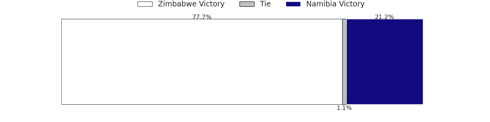
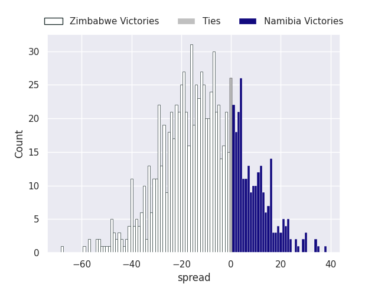

### United States of America V Australia A on 2026/10/25

Average Margin: Australia A by 14.6

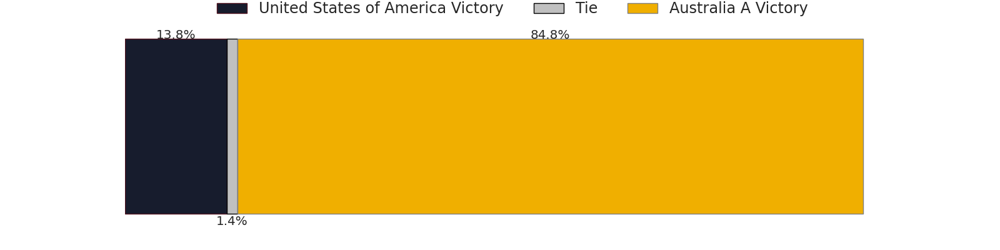

## Week 12

### United States of America V Australia A on 2026/10/31

Average Margin: Australia A by 14.4

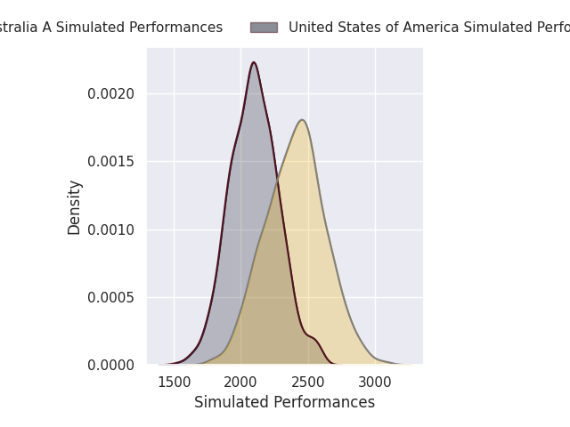
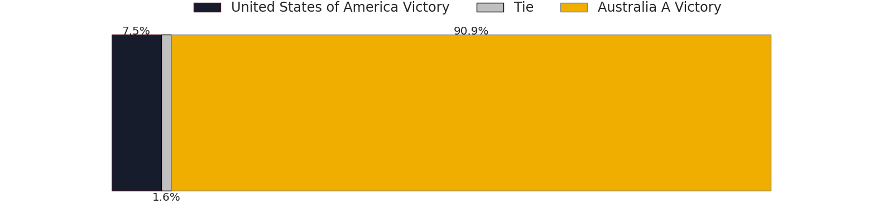
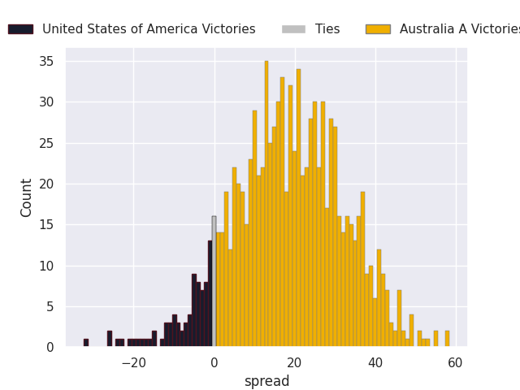

### Belgium V Hong Kong on 2026/10/31

Average Margin: Belgium by 7.4

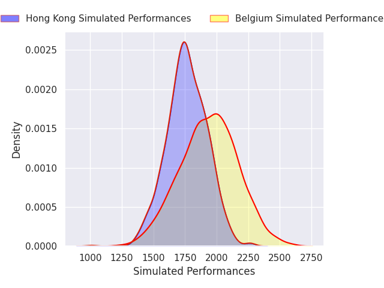
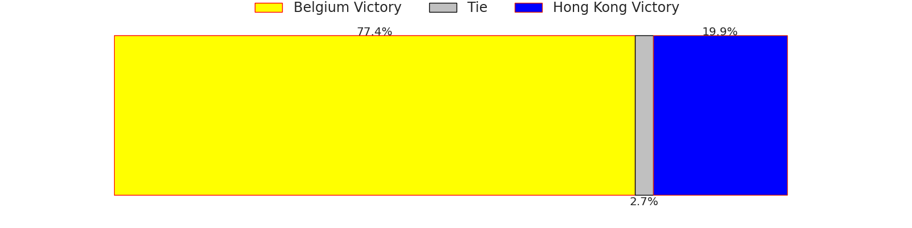
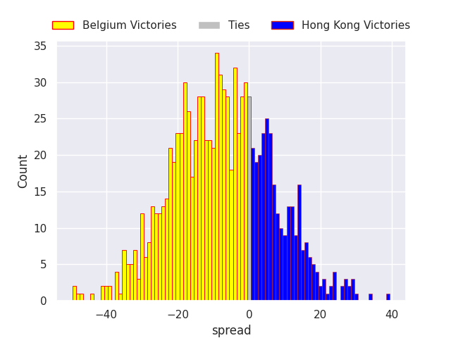

## Week 13

### England A V Argentina A on 2026/11/06

Average Margin: England A by 12.2

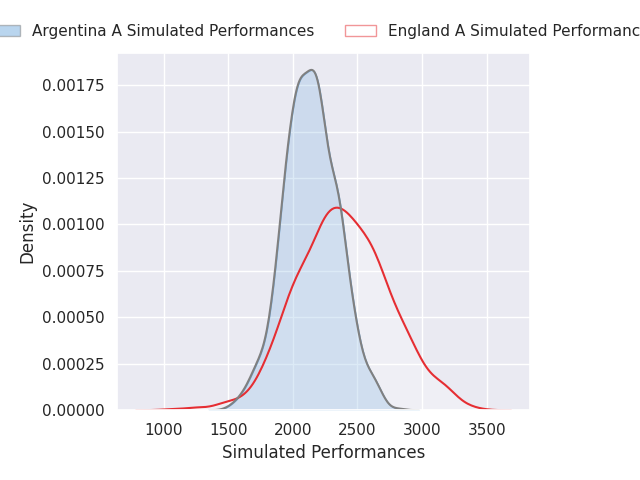
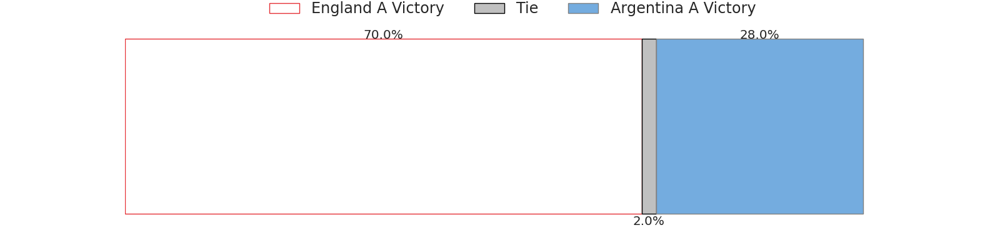
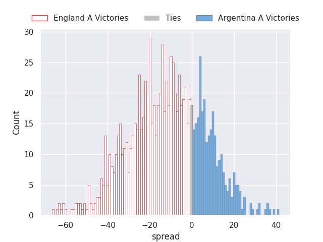

## Week 14

### Paraguay V Brazil on 2026/11/13

Average Margin: Paraguay by 20.8

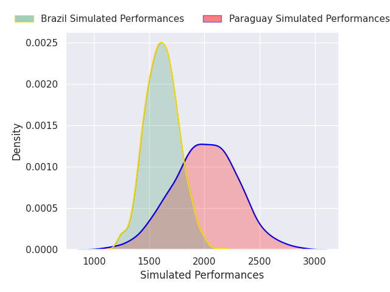
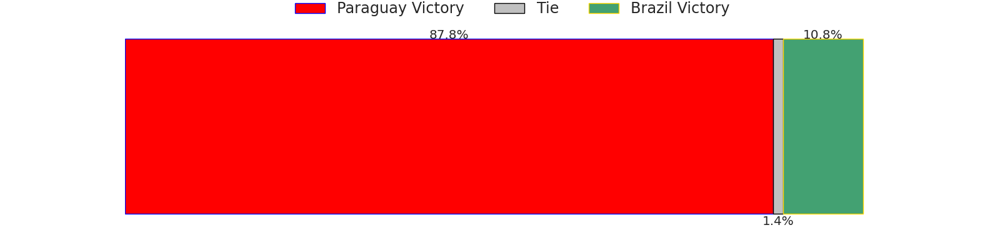
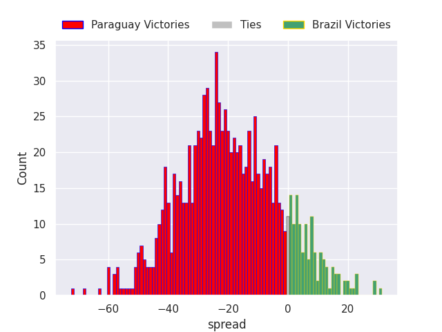

