# Team Rankings

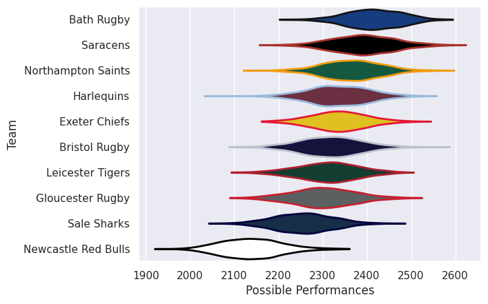
# Standings

## Projected Remaining Table

| Club                |   To Play |   Projected Wins |   Projected Differential |   Projected Losing Bonus Points | Projected Try Bonus Points   |   Projected Competition Points |
|:--------------------|----------:|-----------------:|-------------------------:|--------------------------------:|:-----------------------------|-------------------------------:|
| Saracens            |         3 |            2.023 |                   17.046 |                           0.597 |                              |                          8.849 |
| Exeter Chiefs       |         3 |            1.947 |                    8.978 |                           0.7   |                              |                          8.768 |
| Northampton Saints  |         2 |            1.691 |                   13.53  |                           0.221 |                              |                          7.093 |
| Bath Rugby          |         3 |            1.398 |                    0.313 |                           0.997 |                              |                          6.891 |
| Sale Sharks         |         2 |            1.144 |                    3.538 |                           0.589 |                              |                          5.429 |
| Harlequins          |         2 |            0.967 |                    0.087 |                           0.564 |                              |                          4.592 |
| Bristol Rugby       |         2 |            0.844 |                   -1.463 |                           0.724 |                              |                          4.354 |
| Leicester Tigers    |         2 |            0.839 |                   -2.431 |                           0.653 |                              |                          4.137 |
| Gloucester Rugby    |         2 |            0.352 |                  -11.366 |                           0.778 |                              |                          2.346 |
| Newcastle Red Bulls |         3 |            0.301 |                  -28.232 |                           0.876 |                              |                          2.24  |

## Projected Total Table

| Club                |   Played |   Wins |   Point Differential |   Losing Bonus Points | Try Bonus Points   |   Competition Points |
|:--------------------|---------:|-------:|---------------------:|----------------------:|:-------------------|---------------------:|
| Saracens            |        3 |  2.023 |               17.046 |                 0.597 |                    |                8.849 |
| Exeter Chiefs       |        3 |  1.947 |                8.978 |                 0.7   |                    |                8.768 |
| Northampton Saints  |        2 |  1.691 |               13.53  |                 0.221 |                    |                7.093 |
| Bath Rugby          |        3 |  1.398 |                0.313 |                 0.997 |                    |                6.891 |
| Sale Sharks         |        2 |  1.144 |                3.538 |                 0.589 |                    |                5.429 |
| Harlequins          |        2 |  0.967 |                0.087 |                 0.564 |                    |                4.592 |
| Bristol Rugby       |        2 |  0.844 |               -1.463 |                 0.724 |                    |                4.354 |
| Leicester Tigers    |        2 |  0.839 |               -2.431 |                 0.653 |                    |                4.137 |
| Gloucester Rugby    |        2 |  0.352 |              -11.366 |                 0.778 |                    |                2.346 |
| Newcastle Red Bulls |        3 |  0.301 |              -28.232 |                 0.876 |                    |                2.24  |

# Future Predictions

## Week 1

### Sale Sharks V Bristol Rugby on 2026/11/06

Average Margin: Sale Sharks by 2.4

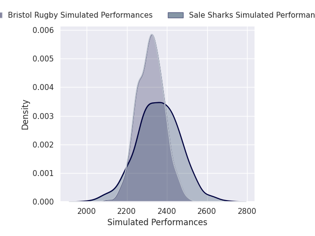

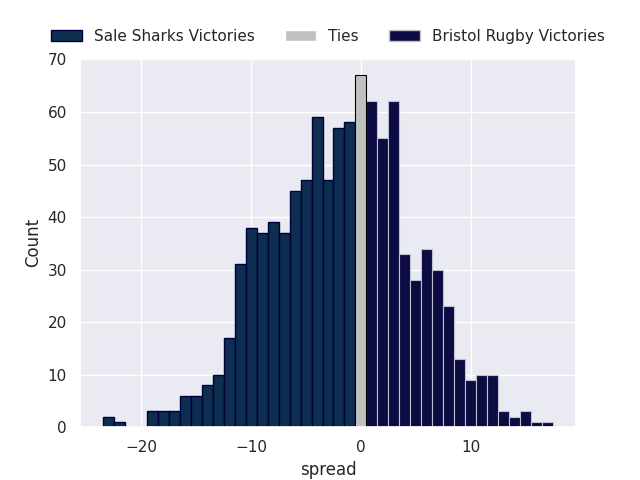

### Northampton Saints V Leicester Tigers on 2026/11/06

Average Margin: Northampton Saints by 6.3

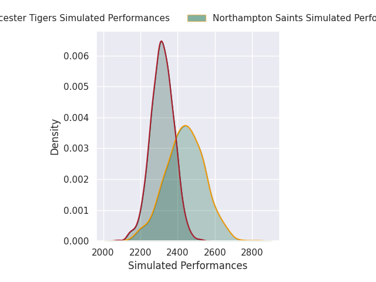
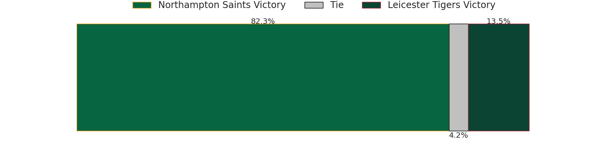
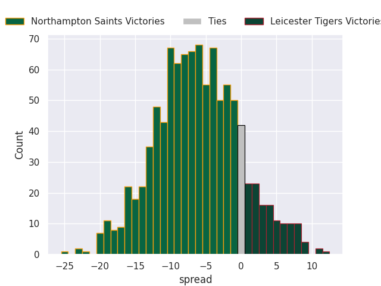

### Saracens V Newcastle Red Bulls on 2026/11/07

Average Margin: Saracens by 15.4

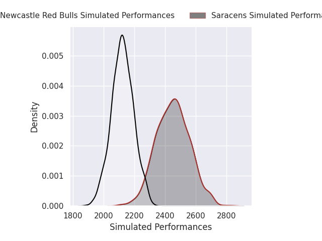

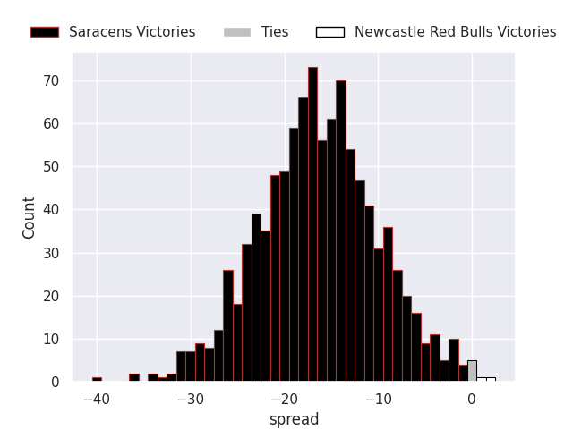

## Week 2

### Sale Sharks V Exeter Chiefs on 2026/11/13

Average Margin: Sale Sharks by 1.2

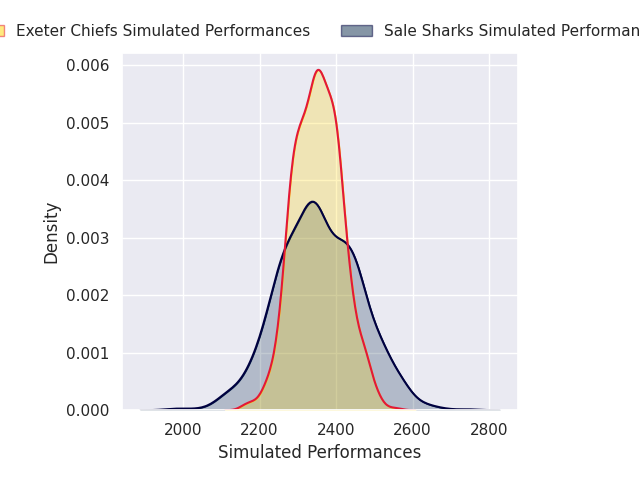

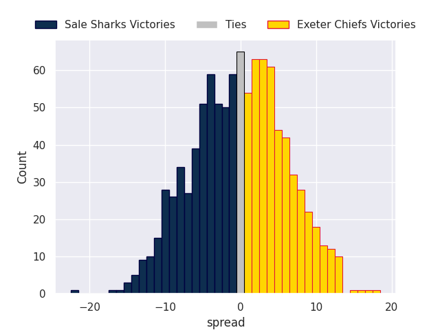

### Bath Rugby V Gloucester Rugby on 2026/11/14

Average Margin: Bath Rugby by 5.4

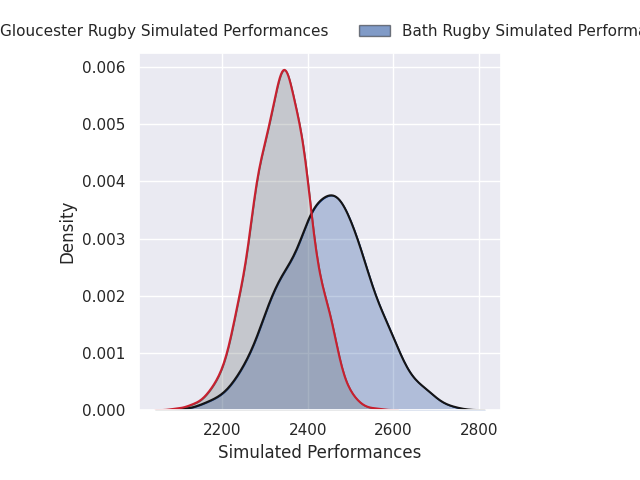
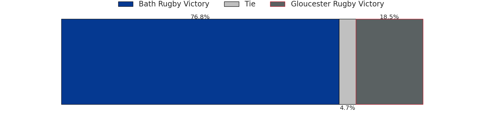
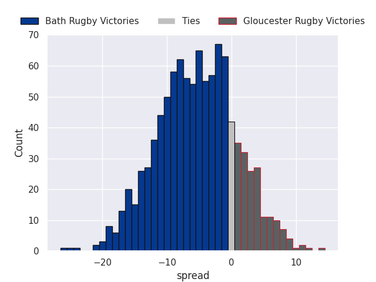

### Newcastle Red Bulls V Harlequins on 2026/11/14

Average Margin: Harlequins by 5.6

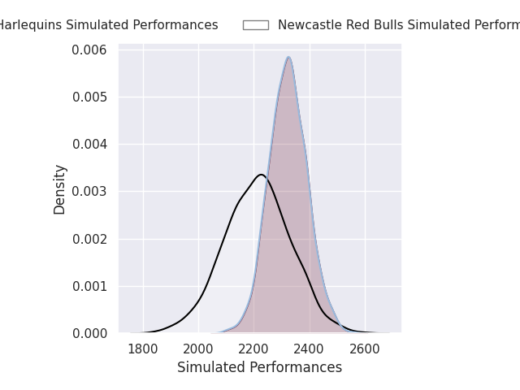
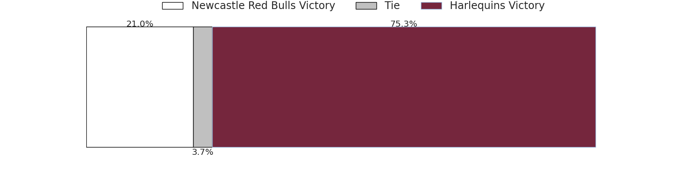
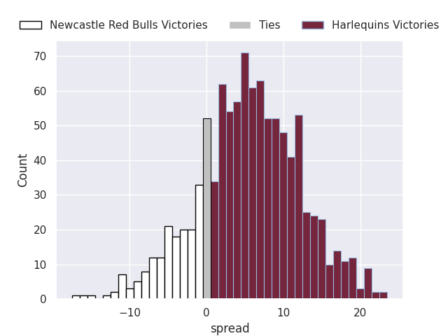

### Leicester Tigers V Saracens on 2026/11/15

Average Margin: Leicester Tigers by 3.9

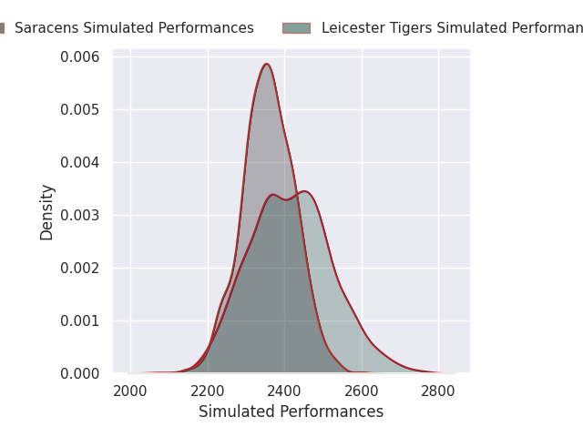

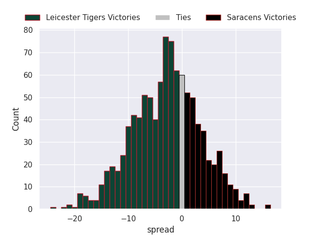

## Week 3

### Bristol Rugby V Bath Rugby on 2026/11/20

Average Margin: Bristol Rugby by 0.9

### Newcastle Red Bulls V Northampton Saints on 2026/11/21

Average Margin: Northampton Saints by 7.2

### Exeter Chiefs V Gloucester Rugby on 2026/11/21

Average Margin: Exeter Chiefs by 5.9

### Saracens V Harlequins on 2026/11/21

Average Margin: Saracens by 5.5

