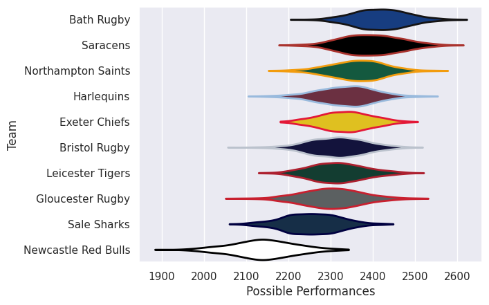
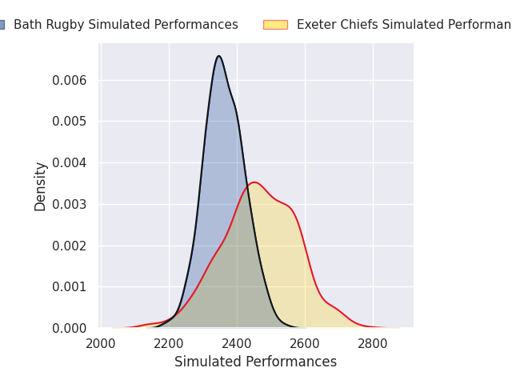
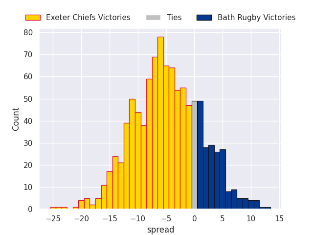

# Team Rankings

# Standings

## Current Standings

| Club                |   Played |   Wins |   Point Differential |   Losing Bonus Points | Try Bonus Points   |   Competition Points |
|:--------------------|---------:|-------:|---------------------:|----------------------:|:-------------------|---------------------:|
| Harlequins          |        2 |      2 |                   39 |                     0 |                    |                    8 |
| Gloucester Rugby    |        2 |      1 |                   14 |                     1 |                    |                    5 |
| Saracens            |        1 |      1 |                   54 |                     0 |                    |                    4 |
| Exeter Chiefs       |        1 |      1 |                   24 |                     0 |                    |                    4 |
| Newcastle Red Bulls |        1 |      1 |                   12 |                     0 |                    |                    4 |
| Sale Sharks         |        2 |      1 |                    5 |                     0 |                    |                    4 |
| Bristol Rugby       |        2 |      1 |                  -21 |                     0 |                    |                    4 |
| Bath Rugby          |        1 |      0 |                  -22 |                     0 |                    |                    0 |
| Leicester Tigers    |        2 |      0 |                  -36 |                     0 |                    |                    0 |
| Northampton Saints  |        2 |      0 |                  -69 |                     0 |                    |                    0 |

## Projected Remaining Table

| Club                |   To Play |   Projected Wins |   Projected Differential |   Projected Losing Bonus Points | Projected Try Bonus Points   |   Projected Competition Points |
|:--------------------|----------:|-----------------:|-------------------------:|--------------------------------:|:-----------------------------|-------------------------------:|
| Saracens            |         1 |            0.981 |                   15.197 |                           0.012 |                              |                          3.95  |
| Northampton Saints  |         1 |            0.82  |                    6.188 |                           0.122 |                              |                          3.49  |
| Exeter Chiefs       |         1 |            0.72  |                    4.129 |                           0.211 |                              |                          3.181 |
| Sale Sharks         |         1 |            0.625 |                    2.546 |                           0.261 |                              |                          2.887 |
| Bristol Rugby       |         1 |            0.312 |                   -2.546 |                           0.409 |                              |                          1.783 |
| Bath Rugby          |         1 |            0.235 |                   -4.129 |                           0.424 |                              |                          1.454 |
| Leicester Tigers    |         1 |            0.136 |                   -6.188 |                           0.401 |                              |                          1.033 |
| Newcastle Red Bulls |         1 |            0.012 |                  -15.197 |                           0.102 |                              |                          0.164 |

## Projected Total Table

| Club                |   Played |   Wins |   Point Differential |   Losing Bonus Points | Try Bonus Points   |   Competition Points |
|:--------------------|---------:|-------:|---------------------:|----------------------:|:-------------------|---------------------:|
| Harlequins          |        2 |  2     |               39     |                 0     |                    |                8     |
| Saracens            |        2 |  1.981 |               69.197 |                 0.012 |                    |                7.95  |
| Exeter Chiefs       |        2 |  1.72  |               28.129 |                 0.211 |                    |                7.181 |
| Sale Sharks         |        3 |  1.625 |                7.546 |                 0.261 |                    |                6.887 |
| Bristol Rugby       |        3 |  1.312 |              -23.546 |                 0.409 |                    |                5.783 |
| Gloucester Rugby    |        2 |  1     |               14     |                 1     |                    |                5     |
| Newcastle Red Bulls |        2 |  1.012 |               -3.197 |                 0.102 |                    |                4.164 |
| Northampton Saints  |        3 |  0.82  |              -62.812 |                 0.122 |                    |                3.49  |
| Bath Rugby          |        2 |  0.235 |              -26.129 |                 0.424 |                    |                1.454 |
| Leicester Tigers    |        3 |  0.136 |              -42.188 |                 0.401 |                    |                1.033 |

# Completed Match Review

| Model | Percent Correct Predictions | Spread Error |
| ------ | ------ | ------ |
| Club Level | 55.6% | 21.1 |
| Player Level: Lineup | nan% | nan |
| Player Level: Minutes | nan% | nan |

# Future Predictions

## Week 3

### Exeter Chiefs V Bath Rugby on 2026/11/07

Average Margin: Exeter Chiefs by 4.1

