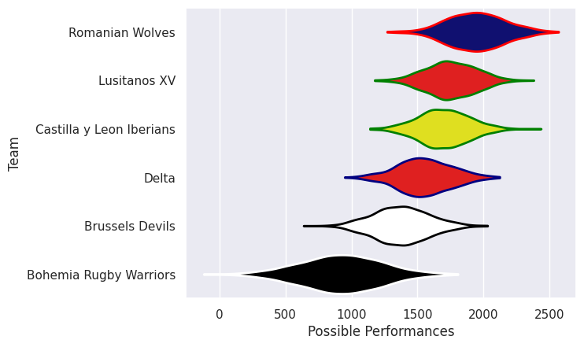
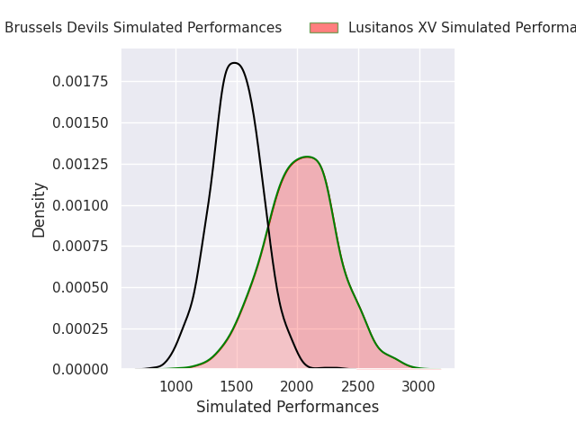
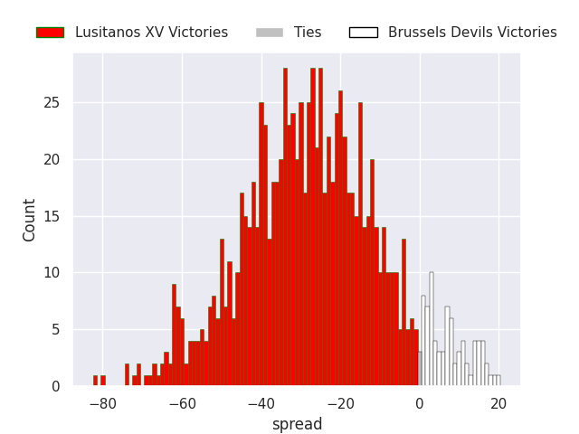
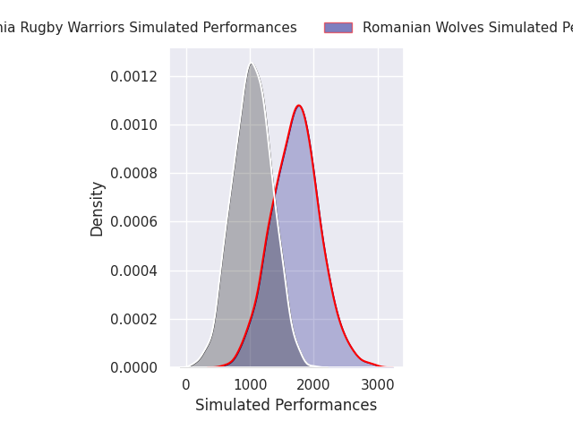
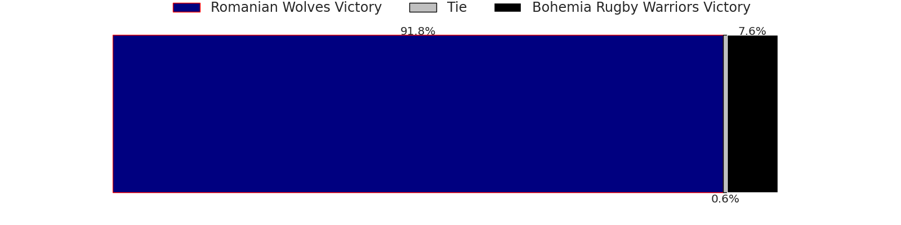
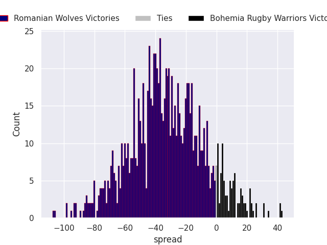
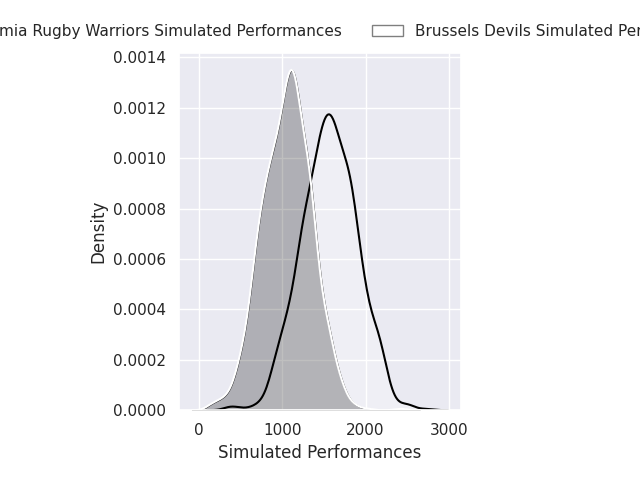
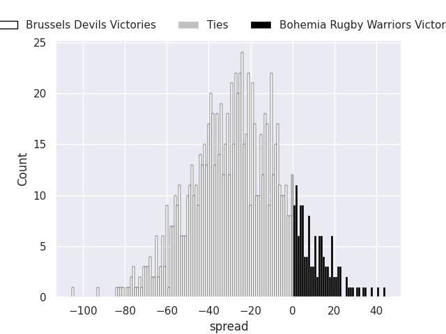
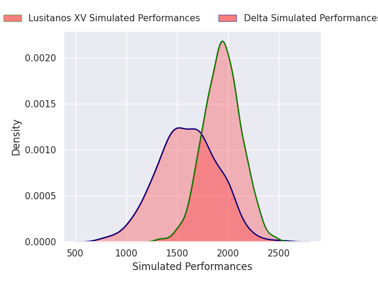
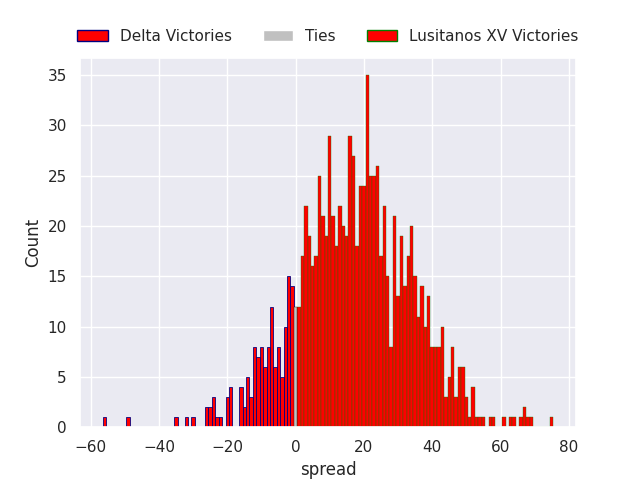

# Team Rankings

# Standings

## Current Standings

| Club                     |   Played |   Wins |   Point Differential |   Losing Bonus Points |   Try Bonus Points |   Competition Points |
|:-------------------------|---------:|-------:|---------------------:|----------------------:|-------------------:|---------------------:|
| Delta                    |        5 |      3 |                   10 |                     1 |                    |                   13 |
| Lusitanos XV             |        4 |      3 |                  158 |                     0 |                    |                   12 |
| Romanian Wolves          |        3 |      2 |                  -59 |                     0 |                  1 |                    9 |
| Castilla y Leon Iberians |        2 |      2 |                   30 |                     0 |                    |                    8 |
| Brussels Devils          |        4 |      0 |                  -62 |                     3 |                  1 |                    4 |
| Bohemia Rugby Warriors   |        2 |      0 |                  -77 |                     0 |                    |                    0 |

## Projected Remaining Table

| Club                   |   To Play |   Projected Wins |   Projected Differential |   Projected Losing Bonus Points | Projected Try Bonus Points   |   Projected Competition Points |
|:-----------------------|----------:|-----------------:|-------------------------:|--------------------------------:|:-----------------------------|-------------------------------:|
| Lusitanos XV           |         2 |            1.78  |                   44.439 |                           0.101 |                              |                          7.271 |
| Brussels Devils        |         2 |            0.912 |                   -1.505 |                           0.132 |                              |                          3.808 |
| Romanian Wolves        |         1 |            0.916 |                   32.532 |                           0.04  |                              |                          3.718 |
| Bohemia Rugby Warriors |         2 |            0.209 |                  -57.466 |                           0.13  |                              |                          1     |
| Delta                  |         1 |            0.141 |                  -18     |                           0.108 |                              |                          0.714 |

## Projected Total Table

| Club                     |   Played |   Wins |   Point Differential |   Losing Bonus Points |   Try Bonus Points |   Competition Points |
|:-------------------------|---------:|-------:|---------------------:|----------------------:|-------------------:|---------------------:|
| Lusitanos XV             |        6 |  4.78  |              202.439 |                 0.101 |                    |               19.271 |
| Delta                    |        6 |  3.141 |               -8     |                 1.108 |                    |               13.714 |
| Romanian Wolves          |        4 |  2.916 |              -26.468 |                 0.04  |                  1 |               12.718 |
| Castilla y Leon Iberians |        2 |  2     |               30     |                 0     |                    |                8     |
| Brussels Devils          |        6 |  0.912 |              -63.505 |                 3.132 |                  1 |                7.808 |
| Bohemia Rugby Warriors   |        4 |  0.209 |             -134.466 |                 0.13  |                    |                1     |

# Completed Match Review

| Model | Percent Correct Predictions | Spread Error |
| ------ | ------ | ------ |
| Club Level | 85.7% | 18.4 |
| Player Level: Lineup | nan% | nan |
| Player Level: Minutes | nan% | nan |

# Future Predictions

## Week 6

### Lusitanos XV V Brussels Devils on 2026/12/05

Average Margin: Lusitanos XV by 26.4

### Romanian Wolves V Bohemia Rugby Warriors on 2026/12/05

Average Margin: Romanian Wolves by 32.5

## Week 7

### Brussels Devils V Bohemia Rugby Warriors on 2026/12/12

Average Margin: Brussels Devils by 24.9

### Delta V Lusitanos XV on 2026/12/13

Average Margin: Lusitanos XV by 18.0

